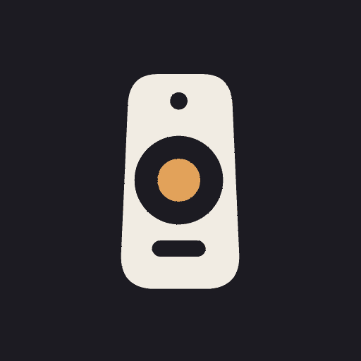

<div align="center">



&nbsp;

&nbsp;

📺

# tutti

[](https://kotlinlang.org)
[](https://developer.android.com)
[](https://developer.android.com/compose)
[](LICENSE)

**A remote for BRAVIA TVs and Theatre Bars**

[Features](#-features) • [Quick Start](#-quick-start) • [Development](#-development) • [Docs](#-docs)

</div>

An Android remote and control app for a Sony BRAVIA 8 TV and a BRAVIA Theatre Bar 9, built to replace BRAVIA Connect for everyday use. It works on the local network without a Sony account; Sony sign-in is an opt-in extra.

Setup, room calibration and speaker placement stay in BRAVIA Connect, and tutti opens it when you need it.

## 🌟 Features

- 🕹️ **Google TV–grade remote** — touchpad or D-pad, with a strip under the pad to switch between them
- ⌨️ **Live keyboard** — type into the TV's text fields from the phone, mirrored as you go
- 🎙️ **Voice** — hold the mic to talk to the TV's Assistant
- 🔊 **Soundbar controls** — volume, sound field, night mode, bass and rear level on the Theatre Bar, over its IP control
- 🎬 **Scenes and shortcuts** — one tap sets the TV input or app, the picture mode and a volume cap; pinned keys and apps on the remote
- 📱 **Widget, Quick Settings tile and media notification** — the essentials without opening the app
- 🔒 **Local and private** — LAN only, devices pinned on first use, pairing material encrypted with an Android Keystore key
- 🩺 **Developer mode** — redacted, copyable details on every error, and a diagnostic of the TV and bar connections

## 🚀 Quick Start

Download the latest `tutti-<version>.apk` from [Releases](../../releases) on the phone and open it (allow installs from your browser or file manager once). Later releases install over it. Then set up the devices:

1. **Soundbar.** In BRAVIA Connect, enable **External control** (IP control) for the Bar 9. The app talks to it on TCP port 33336.
2. **TV, remote.** Nothing to enable. On first launch the app pairs with the TV: the TV shows a 6-character code, type it in the app.
3. **TV, settings (picture, sound output, inputs).** On the TV: *Settings → Network & Internet → Remote device settings → Control remotely* on, *IP control → Authentication* set to **Normal and Pre-Shared Key**, and choose a Pre-Shared Key. Enter the same key in the app.
4. Give the TV and the bar fixed IP addresses on your router (recommended).

## 🔧 Development

```
app/        Android: Compose UI, Hilt, DataStore, sockets/TLS, widget, tile, notification
protocol/   Pure Kotlin/JVM: wire formats, state machines, reducers, device simulator (test fixtures)
docs/       Design direction and architecture
design/     Branding sources
```

| Command | What it does |
| --- | --- |
| `./gradlew :protocol:test` | Protocol unit tests and simulator tests |
| `./gradlew :app:testDebugUnitTest` | App unit tests, including the transports against the loopback simulator |
| `./gradlew :app:lintDebug` | Android lint |
| `./gradlew :app:assembleDebug` | Debug APK |

JDK 17. CI (`.github/workflows/android.yml`) runs tests, lint and a debug build on every push and pull request.

### Release secrets

A `vMAJOR.MINOR.PATCH` tag builds a signed release APK and publishes it on a GitHub Release; a `vMAJOR.MINOR.PATCH-dev.N` tag publishes a pre-release. Signing needs these Actions secrets (*Settings → Secrets and variables → Actions*):

| Secret | Content |
| --- | --- |
| `ANDROID_KEYSTORE_BASE64` | The release keystore, base64-encoded (`base64 -i release.jks`) |
| `ANDROID_KEYSTORE_PASSWORD` | Keystore password |
| `ANDROID_KEY_ALIAS` | Key alias inside the keystore |
| `ANDROID_KEY_PASSWORD` | Key password |

Use one keystore forever: Android only installs an update signed with the same key. Create it once, for example:

```sh
keytool -genkeypair -v -keystore release.jks -alias tutti -keyalg RSA -keysize 4096 -validity 36500
```

Keep it (and its passwords) somewhere safe outside the repo. If a secret is missing, a final release fails: it is never published unsigned or signed with `app/debug.keystore`, the public debug key (password `android`) committed so every debug build installs over the last. Until the key exists, a `-dev` tag still ships that debug build as a pre-release, for test phones only. Each release also carries R8's `mapping.txt`, to read its stack traces. The release key never lives in the repo.

## 🏗 Tech Stack

| Area | Choice |
| --- | --- |
| Language | Kotlin 2.4, JVM 17 |
| UI | Jetpack Compose, Material 3, Glance (widget) |
| Dependency injection | Hilt (KSP) |
| Storage | DataStore, Android Keystore |
| Networking | OkHttp 5, Bouncy Castle, Wire (Android TV Remote v2 protos) |
| Concurrency | Kotlin coroutines and Flow |
| Build | Gradle 9, AGP 9 |

## 📝 Docs

- [`docs/index.mdx`](docs/index.mdx): where to start.
- [`docs/design.md`](docs/design.md): design direction.
- [`docs/architecture.md`](docs/architecture.md): modules, protocols (verified and not), threat model.

## 🙏 Credits

The Android TV Remote v2 protos and pairing hash come from [kud/androidtv-remote](https://github.com/kud/androidtv-remote) (MIT, © 2021 louis49, © 2026 Erwann Mest). Soundbar protocol knowledge from [bravia-quad-homeassistant](https://github.com/steamEngineer/bravia-quad-homeassistant) (MIT), reimplemented.

App logos and icons under `app/src/main/res/` belong to their owners, are used only to identify the app a button opens, and are not covered by the MIT licence. Their sources are listed in [`docs/brand-icons.md`](docs/brand-icons.md).

---

MIT © [kud](https://github.com/kud) — Made with ❤️
