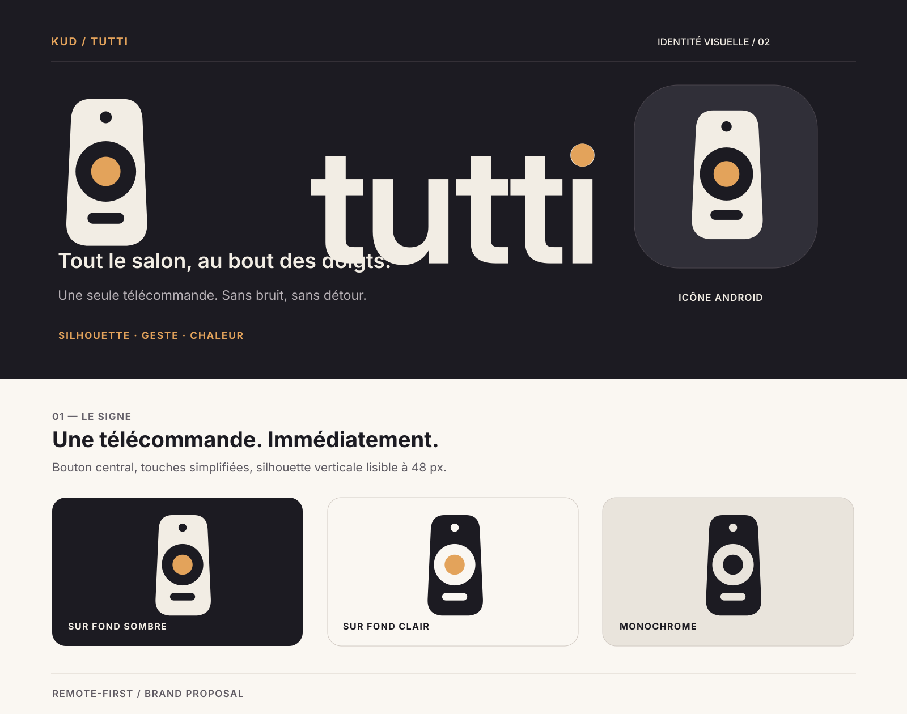
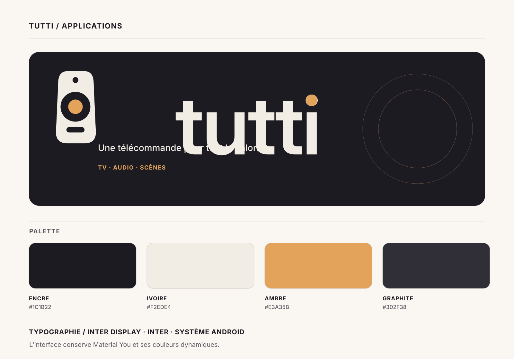

# tutti · Remote-first brand proposal

> **Tout le salon, au bout des doigts.**
>
> **Proposal only:** this folder is for design review. It does not change the installed launcher or Compose interface.

## Idea

The mark must read as a **remote control**, not an abstract monogram reminiscent of a finance or transport app. The gently tapered handset, small power dot, oversized navigation ring and understated bottom control say exactly what the product does. An amber confirmation button makes the symbol warmer without becoming playful or skeuomorphic.

The name *tutti* alludes to playing together: here the television, soundbar and scenes are controlled as one. The mark shows the shared **gesture** rather than drawing several devices around it.

## Visual direction

- A distinct tall handset silhouette with compact functional detail, legible from around **48px**.
- Rounded geometry and an immediate central target, not a sketch of a button-heavy legacy remote.
- Dark-first visual identity, consistent with the existing Android app; no vendor logos, TV outline, antennas or decorative signal rays in the mark.
- The **light** and **monochrome** variants are essential for different Android launcher surfaces.
- Vector wordmark based on outlined Inter Display SemiBold (no bundled font files), with an amber dot on the “i”.
- Quiet graphic repetition in presentations only; never let decoration compete with the remote.

## Core palette

| Token | Hex | Role |
| --- | --- | --- |
| Ink | `#1C1B22` | Dark-first backgrounds |
| Ivory | `#F2EDE4` | Main light symbol, type and surfaces |
| Amber | `#E3A35B` | Central confirmation action |
| Graphite | `#302F38` | Supporting brand surfaces |

**Material You takes precedence** in running Android UI; these are brand presentation colours, not a replacement for dynamic theme colours. Do not communicate connection state through colour alone.

## Review assets

| File | Role |
| --- | --- |
| [Brand board](brand-board.svg) | Symbol, proportions, inverse, monochrome, launcher context |
| [Applications](applications.svg) | Banner, palette and typography |
| [App icon SVG](app-icon.svg) | Full-bleed square, scalable |
| [App icon PNG](app-icon.png) | 512×512 preview of app icon |
| [Symbol](symbol.svg) | Isolated remote in ivory |
| [Symbol on light](symbol-on-light.svg) | Reversed for light surfaces |
| [Monochrome symbol](symbol-monochrome.svg) | Single-colour variant |
| [Horizontal lockup](lockup-dark.svg) | Logomark and outlined wordmark |
| [Inverse lockup](lockup-light.svg) | Light surface version |
| [GitHub cover](github-cover.svg) | Editorial banner |
| [Android foreground sample](android/ic_launcher_foreground.xml) | Candidate native vector, **not installed** |

## Implementation notes

The existing launcher resource files and Kotlin sources remain unchanged. A follow-up integration after review would need launcher mask, Android VectorDrawable validity, dynamic colour and contrast checks, and actual UI screenshots on dark and light themes. Visual boards are illustrations, **not** captures from a compiled APK.
