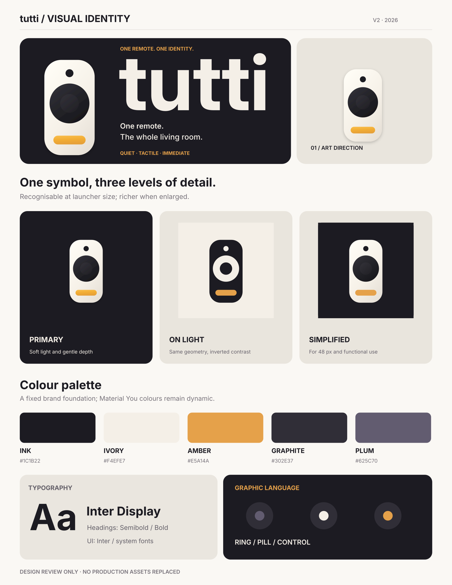
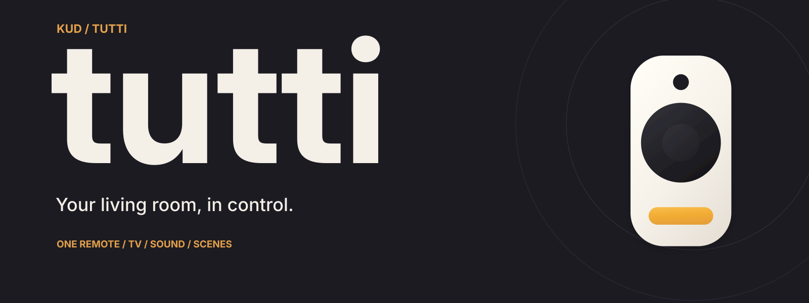

# tutti — Living room remote identity (v2)

> **Your living room, in control.**

## What tutti is

Tutti is **one living room remote-control app** — not a suite of applications, a transport service or a broad smart-home dashboard. It puts the television, soundbar and scenes under one calm, recognisable remote.

This direction keeps the **first selected tactile remote**: an ivory handset, dark circular navigation disc, small top button and single warm amber control. The design should remain unmistakably a remote at launcher size.

## English brand language

- Category: **Living room remote**
- Brand line: **Your living room, in control.**
- Longer line: **Everything in your living room, at your fingertips.**
- Supporting description: **One remote for TV, sound and scenes.**

All brand presentation and assets use English. Android localisation continues to follow `values/` (English) and `values-fr/` (French), outside this PR.

## Palette

| Ink | Ivory | Amber | Night | Graphite |
| --- | --- | --- | --- | --- |
| `#1C1B22` | `#F4EFE7` | `#E5A14A` | `#3E3B52` | `#302E37` |

The brand palette does not replace Material You dynamic UI colouring. Inter Display is a reference for editorial headings; no font files are included. The supplied logotype is outlined vector artwork.

## Review assets

- [Brand board](review-board.svg) — English identity, icon variants and opening-screen compositions
- [GitHub banner](github-cover.svg)
- [Primary icon PNG (512 px)](app-icon.png) and [SVG](app-icon.svg)
- [Light SVG](app-icon-light.svg), [flat SVG](app-icon-flat.svg), [monochrome symbol](symbol-monochrome.svg)
- [Isolated symbol](symbol.svg), [dark wordmark lockup](lockup-dark.svg), [light wordmark lockup](lockup-light.svg)
- [Dark opening study](splash-dark.svg), [light opening study](splash-light.svg), [side-by-side review](splash-review.svg)
- [Android vector foreground candidate](android/ic_launcher_foreground.xml) — design handoff only

## Splash / launch direction

The paired opening studies follow the **selected second branding image**, particularly its launch screens: dark background, centred remote icon with very restrained warm radiance, and a lowercase `tutti` logotype underneath. A matching light treatment uses the same geometry. The imagery is quiet; it should never delay access to the remote.

**These are creative SVG mock-ups, not screenshots of Android system splash or a runtime implementation.** Android system splash does not allow an arbitrary composition with icon and wordmark. If included, the logotype belongs to the app-controlled intro, which should be reconciled with `docs/design.md` and the existing `ui/intro/LaunchIntro.kt` direction. Avoid doubled splash screens, a mismatched resting frame, white flashes, or unnecessary launch latency. Respect reduced motion.

## Integration checks

Before choosing production assets, review the 48 px icon under adaptive masks, the monochrome variant, text clipping on mobile, dark/light launch consistency and the existing intro implementation. The PNG and vector artwork are interpretations of the chosen tactile source, **not pixel-identical exports of the original rendered 3D reference**.

**Scope:** this PR is design-only. No Kotlin, installed launcher resources, UI layout, D-pad, locale resources or application logic is changed. No APK build or on-device check is claimed.
