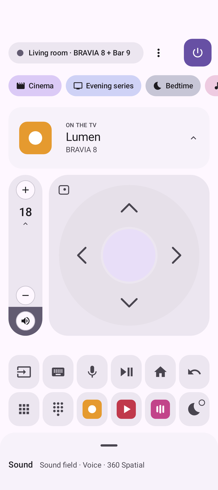
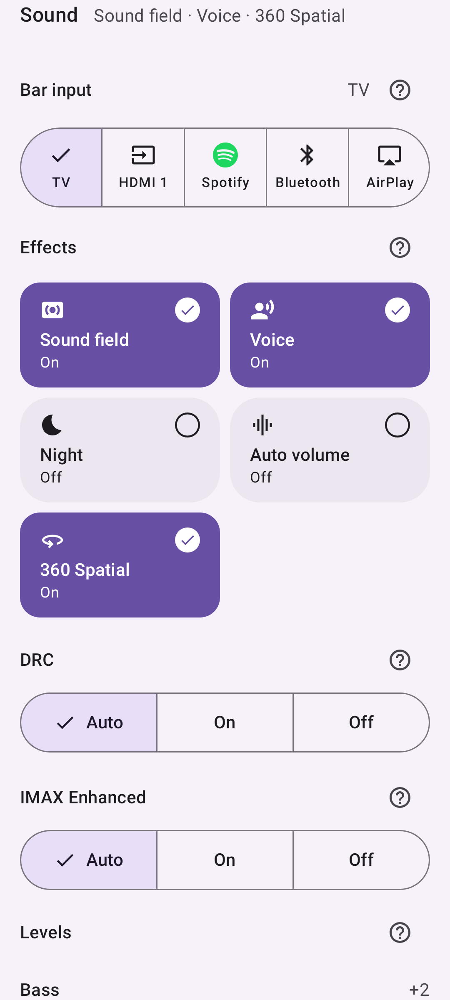
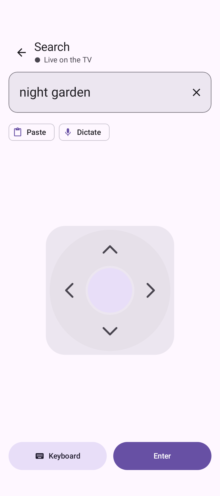

# F-Droid submission

Everything Erwann needs to open the merge request to [`fdroid/fdroiddata`](https://gitlab.com/fdroid/fdroiddata) from his own GitLab account. Background, anti-feature reasoning and the reproducibility design are in [`fdroid.md`](fdroid.md). Prepared on 2026-11-20 against fdroiddata's merge request template (`.gitlab/merge_request_templates/Default.md`), F-Droid's docs (from `fdroid/fdroid-website`, `_docs/`) and fdroidserver master.

## Before the merge request

The first F-Droid version is **0.3.2**, built reproducibly so F-Droid publishes the APK signed with tutti's release key. F-Droid's template is explicit: without reproducible builds "the apk will be signed with our key so you can't enable it later". 0.3.1 cannot be verified (no release-signed fdroid APK, and a dependency-metadata signing block fdroidserver rejects), so it is not submitted.

0. **Wait until 2027-01-20.** F-Droid's inclusion policy, Quality Control point 6 (the one the template asks to "pay special attention" to): "The application should have been actively developed for at least 3 months", unless it has proven users, the author maintains other apps on F-Droid, or it is for an event. tutti's first commit is 2026-10-20, so the earliest submission that meets it is 2027-01-20. None of the exceptions holds yet. Opening the merge request earlier risks it being closed.
1. **Merge** the reproducible-builds pull request (`fix/fdroid-reproducible-builds`): `dependenciesInfo` off, JDK 21 releases, `tutti-<version>-fdroid.apk` attached to final releases after an `apksigcopier compare` against a clean unsigned rebuild.
2. **Tag `v0.3.2`** on that `main` (a final release, so it waits for Erwann's word). The release job must end green: if the fdroid APK does not reproduce, it fails before publishing.
3. **Check the release** carries `tutti-0.3.2.apk`, `tutti-0.3.2-fdroid.apk` and the mapping, and that the fdroid APK is signed with the expected certificate:
   ```sh
   apksigner verify --print-certs tutti-0.3.2-fdroid.apk | grep 'SHA-256'
   # expected: 1acccde4aac64d6605dd8cbd03f0359df931a584518f641f07fad4bb60931af4
   ```
4. **Get the commit hash** the recipe pins (the full hash, never the tag):
   ```sh
   git fetch --tags && git rev-parse 'v0.3.2^{commit}'
   ```

## `metadata/app.beansontoast.tutti.yml`

Replace `V032_FULL_COMMIT_HASH` with the hash from step 4. The same file lives at [`docs/fdroid/app.beansontoast.tutti.yml`](fdroid/app.beansontoast.tutti.yml); `sed -i "s/V032_FULL_COMMIT_HASH/$(git -C <tutti> rev-parse 'v0.3.2^{commit}')/" metadata/app.beansontoast.tutti.yml` fills it in.

```yaml
AntiFeatures:
  NonFreeAssets:
    en-US: App buttons show third-party app logos and icons (some taken from 
      Google Play) to identify the app a button opens; they are not under a free
      licence.
    fr-FR: Les boutons d’applis affichent des logos et icônes d’applis tierces 
      (certains tirés de Google Play) pour reconnaître l’appli ouverte ; ils ne 
      sont pas sous licence libre.
  NonFreeNet:
    en-US: 'Optional and off by default, each behind its own switch and all off under
      “Only free services”: Title details sends the IMDb id of what is playing to
      Stremio’s Cinemeta, and Cast artwork fetches the picture the TV names from YouTube,
      Google, TMDB or Stremio image hosts. The Trakt, JustWatch and IMDb buttons open
      those sites when tapped.'
    fr-FR: 'Facultatif et désactivé par défaut, chacun derrière son interrupteur et
      tous coupés par « Services libres uniquement » : les détails du titre envoient
      l’identifiant IMDb de ce qui passe à Cinemeta (Stremio), et l’image Cast est
      récupérée auprès des hébergeurs d’images de YouTube, Google, TMDB ou Stremio.
      Les boutons Trakt, JustWatch et IMDb ouvrent ces sites quand on les touche.'
Categories:
  - Connectivity
  - Multimedia
  - Remote Controller
License: MIT
AuthorName: Erwann Mest
SourceCode: https://github.com/kud/tutti
IssueTracker: https://github.com/kud/tutti/issues
Changelog: https://github.com/kud/tutti/releases

AutoName: tutti

RepoType: git
Repo: https://github.com/kud/tutti.git
Binaries: https://github.com/kud/tutti/releases/download/v%v/tutti-%v-fdroid.apk

Builds:
  - versionName: 0.3.2
    versionCode: 300299
    commit: V032_FULL_COMMIT_HASH
    subdir: app
    sudo:
      - apt-get update
      - apt-get install -y openjdk-21-jdk-headless
      - update-alternatives --auto java
    gradle:
      - fdroid
    gradleprops:
      - tutti.versionName=0.3.2
      - tutti.versionCode=300299

AllowedAPKSigningKeys: 1acccde4aac64d6605dd8cbd03f0359df931a584518f641f07fad4bb60931af4

AutoUpdateMode: None
UpdateCheckMode: None
CurrentVersion: 0.3.2
CurrentVersionCode: 300299
```

The two trailing spaces after "logos and icons (some taken from" and in the French lines are what `fdroid rewritemeta` writes; keep them. Before pushing, from the fdroiddata clone (fdroidserver installed, or its Docker image as in `fdroid.md`):

```sh
fdroid readmeta
fdroid rewritemeta app.beansontoast.tutti   # keep whatever it changes
fdroid lint app.beansontoast.tutti
fdroid build -v -l app.beansontoast.tutti   # downloads Binaries and compares
```

These have not been run on this version of the recipe yet; the merge request's pipeline runs all of them.

## Merge request

**Title**

```
New app: tutti
```

**Description** (fdroiddata's default template, `.gitlab/merge_request_templates/Default.md`, copied verbatim section by section with every checkbox; answers are indented under their item)

````markdown
<!--TEMPLATE FOR NEW APP INCLUSION! For updates or other types of MRs replace the text below-->


## Abstract for new app inclusion

### Please introduce the functions and usage of your app in summary, and also attach some screenshots.

tutti is a remote for one living room: a Sony BRAVIA TV on Google TV, a BRAVIA Theatre Bar, and the computer shown on the TV. It replaces Sony's BRAVIA Connect for everyday use and works entirely on the local network: no Sony account, no cloud service, no analytics.

- Remote with touchpad or D-pad, live keyboard into the TV's text fields, and voice (hold the mic for the TV's Assistant), over the Android TV Remote v2 protocol
- Soundbar control over the Theatre Bar's IP control (TCP 33336): volume, sound field, night mode, bass and rear level
- Scenes (one tap sets input or app, picture mode and a volume cap), a widget, Quick Settings tiles, a media notification, a switch-off timer
- Devices pinned on first pairing; pairing material encrypted with an Android Keystore key and excluded from backups

Anti-features, declared in the recipe: `NonFreeAssets` (app buttons show third-party app logos, some taken from Google Play) and `NonFreeNet` (optional features, each off by default and all off under "Only free services", reach Stremio's Cinemeta and image hosts: YouTube, Google, TMDB, Stremio). The rest of the traffic is to the user's own TV and soundbar on the LAN (Android TV Remote v2 over TLS, the bar's IP control, Sony's local REST API, Cast, mDNS, Wake-on-LAN); I did not declare NonFreeNet for that local control, since it reaches the user's own device with no service in between, and I'm glad to change it if you read it differently. Setup and room calibration hand off to Sony's BRAVIA Connect (its store page when missing), which I did not count as NonFreeAdd. The recipe builds the `fdroid` flavour, which has no self-updater (no `REQUEST_INSTALL_PACKAGES`, no update code; a Gradle check and a unit test enforce it); the `github` flavour keeps its updater for GitHub installs. Dependencies: AndroidX/Compose, Hilt, Kotlin, kotlinx, OkHttp, Wire, BouncyCastle, from Google Maven and Maven Central; no Play Services, Firebase or Cast SDK.

Screenshots (rendered from invented fixtures, also in the fastlane folder):





### Please elaborate why you wrote this app. Please highlight the unique functions it provides over other similar apps in F-Droid.

I wrote it to stop depending on BRAVIA Connect, which needs a Sony account and the cloud for things that happen in one room. tutti drives the TV and the soundbar together from one screen, talking to both directly on the LAN; the Theatre Bar's IP control and the scenes that set TV and bar at once are what a generic Android TV remote does not offer.

## Checklist

### Policy

* [x] The app complies with the [inclusion policy](https://f-droid.org/docs/Inclusion_Policy). _Pay special attention to Quality point 6._
* [x] The original app author has been notified (and does not oppose the inclusion). If you are not the author, please paste the link of the reply from the author.
  I am the author.
* [x] The upstream app source code repo contains the app metadata in a [Fastlane](https://gitlab.com/snippets/1895688) or [Triple-T](https://gitlab.com/snippets/1901490) folder structure. The summary and description must be included and images, icon, and changelog should also be provided for better user experience. The `en-US` locale must be included.
  `fastlane/metadata/android/` has `en-US` and `fr-FR`: title, short and full description, changelogs, icon (en-US) and six phone screenshots each.

### Docs

* [x] Please read [the guide](https://gitlab.com/fdroid/fdroiddata/-/blob/master/CONTRIBUTING.md) first if this is your first contribution.
* [x] Please make sure your metadata follows the best practice in [our templates](https://gitlab.com/fdroid/fdroiddata/tree/master/templates).
* [x] Please read the [Build Metadata Reference](https://f-droid.org/docs/Build_Metadata_Reference/) and make sure your metadata is valid.
* [x] Please read the [Quick Start Guide](https://f-droid.org/en/docs/Submitting_to_F-Droid_Quick_Start_Guide/).

### Merge Request Setup

* [x] The title of this merge request should follow "New app: app name" format.
* [x] Please make sure your fdroiddata fork is public and your branch is not protected. See <https://docs.gitlab.com/user/project/repository/branches/protected/>.
* [x] Please read [our Git guide](https://gitlab.com/fdroid/wiki/-/wikis/Tips-for-fdroiddata-contributors/Git-Usage) if you don't know how to rebase your branch. Don't rebase your branch if there is no conflict.
* [x] All related [fdroiddata](https://gitlab.com/fdroid/fdroiddata/issues) and [RFP issues](https://gitlab.com/fdroid/rfp/issues) have been referenced in this merge request
  There are none.
* [x] Please only submit one app in one MR.

### Metadata

* [x] Metadata must be put in `metadata/<applicationId>.yml`.
* [x] Metadata must be a valid YAML file.
* [x] Metadata must use LF as line ending.
* [x] Don't add summary/description/changelog/images or anything that should be provided in upstream repo. Please check the Changes tab to make sure there is no other unrelated files added in the MR.
* [ ] Releases are tagged and auto update is enabled unless there is a special reason.
  Releases are tagged (`vMAJOR.MINOR.PATCH`; `-dev.N` tags are pre-releases), but auto update is off for now: versionName and versionCode are derived from the tag by CI (`(MAJOR×1000000 + MINOR×1000 + PATCH)×100 + 99`) and passed to Gradle, so no file at the tag holds them for checkupdates to read. I add each release's `Builds` entry by hand and am happy to move the version into `gradle.properties` if you prefer auto updates.
* [x] There is an issue tracker and contact info of the author so that we can report bugs and contact the author.
* [x] An AuthorName must be added. It doesn't need to be the real name.
* [x] External repos are added as git submodules instead of srclibs. You can update git submodules without opening an MR in this repo and the submodule is covered by our scanner.
  None are used.
* [x] Enable [Reproducible Builds](https://f-droid.org/docs/Reproducible_Builds). We'll use your signature for improved security/reliability, also allowing users to switch between different channels. Do note that if you don't enable reproducible build then the apk will be signed with our key so you can't enable it later. If you can't enable this, please add the reasons here.
  Enabled. `Binaries` points at the release's `tutti-%v-fdroid.apk`, built from the same commit with JDK 21, prebuilt native libraries kept as published (no NDK strip); every final release checks it with `apksigcopier compare` against a clean unsigned rebuild before publishing. `AllowedAPKSigningKeys` is the release certificate.
* [x] Setup abi split if the APK is large and the splitted ones can be much smaller.
  The only native code is two small prebuilt AndroidX libraries (about 70 KB across four ABIs), so one universal APK.
* [x] Only the latest versions should be kept in the metadata before it's merged. If you update the metadata, please replace the old versions with the new ones.
* [x] Don't add any disabled versions in the metadata.
* [x] The `commit` field should be the full hash. Please don't use tag or branch in commit.

### Pipeline

* [ ] All pipelines should pass.
* [ ] All warnings and errors in the Reports tab should be fixed or explained.
* [x] F-Droid CI runners are under GitLab's FOSS program, so there's no need for you to pay for any CI time. If Gitlab starts asking for phone numbers or credit cards don't submit anything, just leave a note in the MR so we know we need to trigger the CI.

---------------------

<!--Add the corresponding issue number or remove this if this merge request does not close an issue at rfp.-->

/label ~"New App"
````

The template's `Closes rfp#<RFP issue number>` line is dropped, as its own comment asks when no RFP issue exists; the comment itself stays.

## Ticking honestly

Two boxes stay open on purpose. "Auto update" is explained in its line. "All pipelines should pass" and "Reports tab" can only be ticked once the pipeline has run: the `fdroid build` job is the first real build of tutti on F-Droid's server (AGP 9.5.1, Gradle 9.9.1, compileSdk 37). If it fails on the SDK platform, adding `prebuild: sdkmanager 'platforms;android-37'` to the build entry is the usual fix; the exact package name should be read from the failing log.

## Donate field (not added)

The recipe has no `Donate` entry. If a "buy me a coffee" link exists one day, F-Droid's inclusion policy wants it verifiable from the developer's own channels (a `FUNDING.yml`, `funding.json` or the README), so it would go in the README (and `.github/FUNDING.yml`) first, then in the recipe's `Donate:` list (an `https://` URL; Liberapay and Open Collective also have their own fields). An in-app link is a separate product decision.
